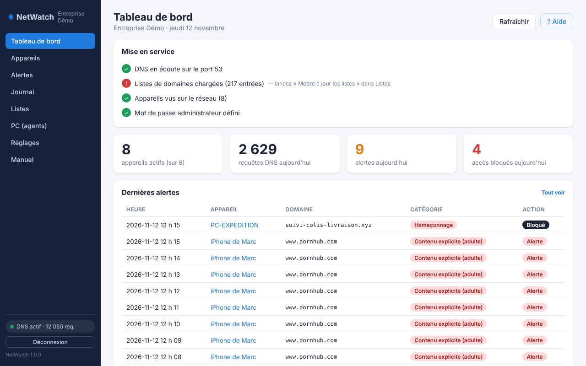
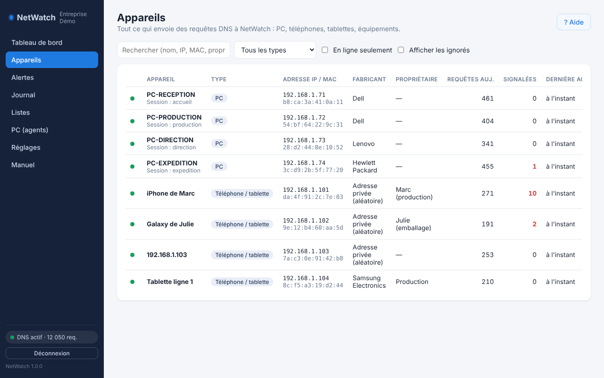
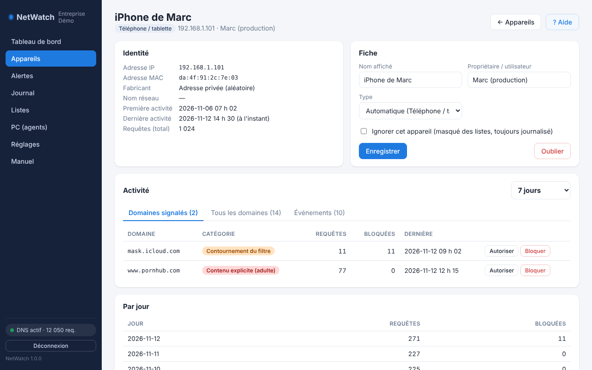
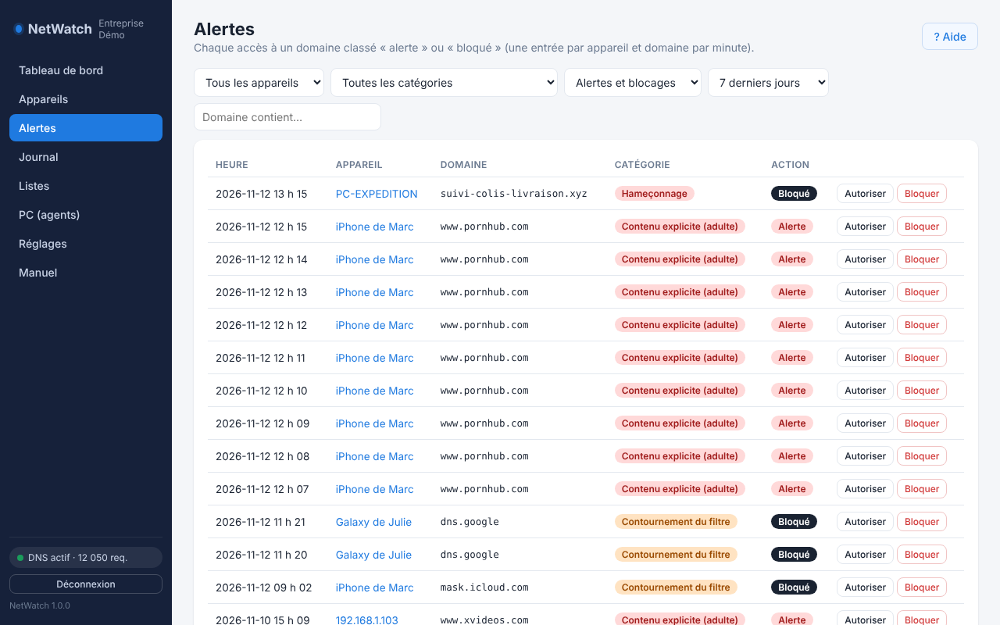
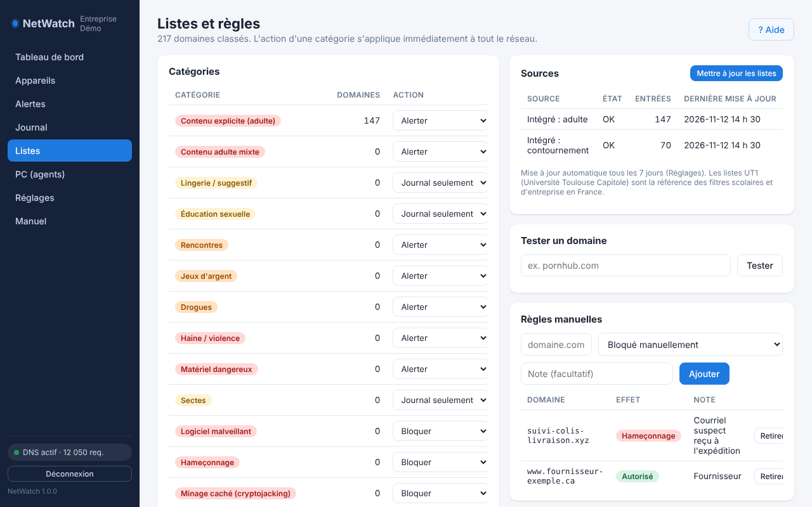

# NetWatch

**DNS-level network monitoring and filtering for a small business, in pure standard-library Python.**

Every PC, phone and tablet on the office network asks NetWatch where the sites it visits live. NetWatch logs those requests per device, classifies each domain against 5 million+ known domains (explicit content, gambling, malware, phishing, filter-bypass services…), raises alerts and can block — all from a French web dashboard. It was built for, and runs in production on, a real company network of PCs, staff phones and warehouse devices.



*Screenshots use a demo company and fictional devices and people.*

## Highlights

- **A DNS server written from scratch.** It has its own DNS wire-format parser and builder (`app/dnslib.py`) and serves UDP and TCP on port 53. It caches answers, fails over between upstream servers and sinkholes blocked domains. Active Directory traffic (SRV lookups, dynamic `UPDATE`/`NOTIFY`) is relayed untouched, so the Windows domain keeps working behind it.
- **Zero dependencies.** It needs Python 3.9+ and nothing from pip, so it deploys by copying a folder onto a Windows Server with a bundled Python.
- **Fast enough to sit in the path of every request:**
  - lookups take ~0.2 ms when cached and ~6.7 ms uncached, including the upstream round trip;
  - it uses ~46 MB of RAM;
  - importing the full 5.4 M-domain list takes ~42 s;
  - during a full list update, 720 test lookups had 0 timeouts and a worst case of 51 ms. Database writes are batched on their own thread, so a busy SQLite file never delays an answer.
- **Classification pipeline** (`app/classify.py`): manual rules first, then the UT1 (Université Toulouse Capitole) and StevenBlack lists, then a keyword fallback, all behind an LRU cache.
- **Device discovery** (`app/devices.py`): ARP, reverse DNS, NetBIOS and mDNS names, plus an IEEE OUI vendor lookup. It also guesses each device's type (PC, phone, printer…) and handles phones that randomize their MAC address.
- **Bypass resistance:**
  - it answers NXDOMAIN to the Firefox DoH canary and to iCloud Private Relay;
  - it blocks known DoH providers;
  - an optional PowerShell agent turns off encrypted DNS in Chrome, Edge, Firefox and Windows by local policy, and reports the signed-in user.
- **Secure web app with no framework:**
  - passwords are stored as PBKDF2 hashes;
  - sessions use HMAC-signed cookies;
  - the JSON API sits behind authentication;
  - the UI is a vanilla-JS single-page app with a built-in illustrated manual.
- **Alerts:** e-mail through SMTP/STARTTLS, with a per-device cooldown and an optional daily digest.
- **Hardened for Windows Server:**
  - it ships Mozilla's CA bundle, because Server's root store is missing certificates that browsers fetch on demand and Python doesn't;
  - it runs as a SYSTEM scheduled task that restarts itself;
  - one script handles the firewall rules, install, update and uninstall.

## Privacy by design

NetWatch records **domain names only**: never page content, URLs inside a site, screenshots or keystrokes. Logs are kept for 90 days by default. It comes with an employee notice template ([docs/AVIS-SURVEILLANCE-RESEAU.md](docs/AVIS-SURVEILLANCE-RESEAU.md)) written for Québec's Law 25 and Charter, because monitoring is only lawful and useful when people are told about it first.

## How it works

```
phone / PC ──(DNS, port 53)──► NetWatch
                                 │ 1. classify the domain (rules → lists → keywords)
                                 │ 2. log it (device, domain, day, count)
                                 │ 3. alert or block according to the category
                                 └──(relay)──► company DNS / Active Directory ──► Internet
```

DHCP hands out NetWatch as the network's DNS server, so every device goes through it without any setup on the device.

| Devices | Device details |
|---|---|
|  |  |
| **Alerts** | **Lists and rules** |
|  |  |

## Try it

You don't need admin rights or port 53:

```bash
python netwatch.py --dns-port 5300 --web-port 8796 --no-blockpage --data data-test
```

Open http://127.0.0.1:8796/, choose a password, then send it a query:

```bash
nslookup -port=5300 www.example.com 127.0.0.1
```

Tests (22, standard library `unittest`):

```bash
python qa/test_netwatch.py
```

The manual screenshots are regenerated with demo data by `python qa/manual_shots.py --skip-lists`. It drives headless Chrome over the DevTools protocol with a hand-written WebSocket client (`qa/cdp.py`).

## Layout

```
netwatch.py        launcher
app/               dnsproxy, dnslib, classify, store (SQLite), devices, lists_update, alerts, web, core
static/            single-page UI + built-in manual
seeds/             built-in lists, vendor prefixes, CA bundle
agent/             PowerShell agent for company PCs
install.ps1        Windows Server install / update / uninstall
qa/                tests and screenshot tooling
docs/              employee notice, router/DHCP/phone guide (French)
README.fr.md       full installation and operations guide (French)
```

## Built with

Python standard library (`socket`, `sqlite3`, `http.server`, `ssl`, `threading`) · vanilla JavaScript · PowerShell · SQLite.
